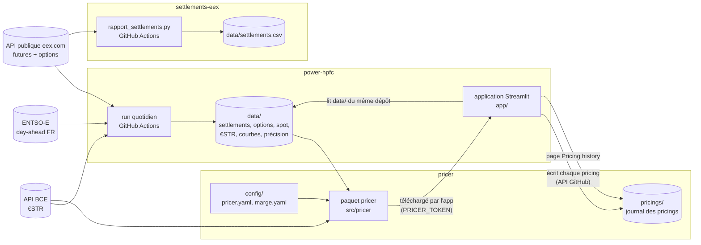

# Notice détaillée — power-hpfc

Cette notice décrit **tout ce que calcule power-hpfc et comment** : chaque donnée récupérée, chaque contrôle,
chaque formule, chaque paramètre, et la façon dont ce dépôt s'articule avec `pricer` et `settlements-eex`.
Les noms de fichiers, de fonctions et de paramètres sont ceux du code ; les valeurs citées sont celles de
`config/FR.yaml`.

Sommaire

1. [Les trois dépôts et leurs dépendances](#1-les-trois-dépôts-et-leurs-dépendances)
2. [Le run quotidien (GitHub Actions)](#2-le-run-quotidien-github-actions)
3. [Données de marché récupérées](#3-données-de-marché-récupérées)
4. [Calendrier, heures peak et types de jour](#4-calendrier-heures-peak-et-types-de-jour)
5. [Construction de la HPFC](#5-construction-de-la-hpfc)
6. [Contrôles de la courbe et métadonnées](#6-contrôles-de-la-courbe-et-métadonnées)
7. [Archive `data/`](#7-archive-data)
8. [Précision de la HPFC](#8-précision-de-la-hpfc)
9. [Application web (Streamlit)](#9-application-web-streamlit)
10. [Paramètres (`config/FR.yaml`)](#10-paramètres-configfryaml)
11. [Ligne de commande](#11-ligne-de-commande)
12. [Règles transverses et limites](#12-règles-transverses-et-limites)

---

## 1. Les trois dépôts et leurs dépendances



| Dépôt | Rôle | Dépend de | Utilisé par |
|---|---|---|---|
| **power-hpfc** | Données de marché archivées chaque jour, HPFC France, précision de la HPFC, application web | APIs publiques EEX, ENTSO-E (clé), BCE | `pricer` (bibliothèque `hpfc` + archive `data/`) ; l'application web |
| **pricer** | Pricing des deals : prix fixe couvert, indexé spot, options EEX ; journal des pricings | `power-hpfc` : paquet `hpfc` (lecture de l'archive) et dossier `data/` ; API BCE | L'application web de power-hpfc, qui télécharge son code |
| **settlements-eex** | E-mail quotidien des settlements EEX (power, gaz, garanties d'origine) et historique CSV | API publique EEX | Personne : autonome |

Sens des dépendances, en détail :

- **pricer → power-hpfc.** `pricer.market.Market.load(chemin du clone power-hpfc)` importe le paquet `hpfc`
  (`hpfc.archive`, `hpfc.config`) installé depuis ce clone (`pip install -e`). Il vérifie que le paquet importé
  vient bien du même dossier, puis lit dans `data/` :
  - la dernière courbe ;
  - les settlements de sa séance ;
  - le spot ENTSO-E ;
  - toutes les séances de futures (pour la volatilité historique) ;
  - les options EEX ;
  - le journal €STR.

  La définition du peak et la tolérance de reproduction des settlements viennent aussi de `config/FR.yaml`.
  En local, `Market.load(..., sync=True)` fait d'abord un `git pull --ff-only` de power-hpfc. Il refuse si
  `data/` a été modifié localement.
- **Application (power-hpfc/app) → pricer.** En ligne, la page Pricer télécharge l'archive du dernier commit du
  dépôt `menckley/pricer` avec le secret Streamlit `PRICER_TOKEN`. Le code est rechargé quand un commit
  touche `src/` ou `config/` (vérification toutes les 5 minutes). En local, elle utilise le paquet `pricer`
  installé.
- **Application → journal du pricer.** Chaque pricing enregistré est écrit dans `pricings/` du dépôt pricer
  par l'API GitHub, avec le même jeton. Le jeton a besoin de *Contents : Read and write* sur ce seul dépôt. La
  page *Pricing history* relit ce journal.
- **settlements-eex** ne lit ni n'écrit rien des deux autres. Il utilise la même API EEX `table-data`, avec son
  propre code.

---

## 2. Le run quotidien (GitHub Actions)

Fichier `.github/workflows/daily.yml`. Déclenchement chaque jour à 05:00 UTC, soit 07:00 à Paris en hiver et
08:00 en été. Il peut aussi être lancé à la main (*Run workflow*). `concurrency` empêche deux runs simultanés.
Durée maximale : 90 minutes.

| Étape | Commande | Si elle échoue |
|---|---|---|
| 1. Tests | `python -m pytest -q` | le run s'arrête : aucune courbe n'est produite avec du code qui ne passe pas ses tests |
| 2. Courbe | `python -m hpfc.cli run --market FR` (secret `ENTSOE_API_KEY`) | le run s'arrête |
| 3. €STR | `python -m hpfc.cli estr` | `continue-on-error` : rattrapé au run suivant, sans trou |
| 4. Options EEX | `python -m hpfc.cli options --market FR` | `continue-on-error` |
| 5. Précision | `python -m hpfc.cli accuracy --market FR` | `continue-on-error` |
| 6. Archive | `git add data` puis commit « Archive HPFC FR AAAA-MM-JJ » et push, seulement s'il y a du nouveau | — |

L'ordre compte. Les options ne sont archivées que pour des séances déjà couvertes par les futures (étape 2,
voir §3.3). La précision relit les courbes et le spot que l'étape 2 vient d'archiver.

---

## 3. Données de marché récupérées

Règle commune à tout le dépôt : `marketdata.errors.DataNotFoundError`. Une donnée absente, incomplète ou
incohérente arrête le traitement concerné avec un message explicite. **Aucune valeur n'est jamais
inventée ni interpolée.**

### 3.1 Settlements des futures EEX (`src/marketdata/eex.py`)

- **Source.** La requête `table-data` que fait la page eex.com
  (`https://api.eex-group.com/pub/market-data/table-data`). Elle ne demande ni compte ni clé. Ce n'est pas
  l'offre payante DataSource. Elle n'est pas documentée et ne garde qu'environ 45 jours de séances.
- **Paramètres de la requête.** `shortCode`, `commodity=POWER`, `pricing=F`, `area=FR`, `product`
  (Base/Peak), `maturity` (AAAAMM), `startDate`, `endDate`, `maturityType`, `isRolling=true`.
- **Codes France.**

| Produit | Base | Peak |
|---|---|---|
| Mois / trimestre / année | F7BM / F7BQ / F7BY | F7PM / F7PQ / F7PY |
| Jour | F7 + numéro du jour (F707 = le 7) | P7 + numéro |
| Week-end | F7W + rang | P7W + rang |
| Semaine | F7B + rang | F7P + rang |

- **Règles de nommage vérifiées.**
  - Mois, trimestre et année : `maturity` = premier mois de livraison.
  - Week-ends et semaines : rattachés au mois de leur **dimanche**, et numérotés par le rang de ce dimanche dans
    le mois (`sunday_slot`). Exemple : la semaine du 28/09 au 04/10/2026 est F7B1 d'octobre.
- **Contrats interrogés à chaque séance** (`listed_candidates`). Seuls les contrats dont la livraison est
  strictement postérieure à la séance sont interrogés :
  - les `n_months` = 6 prochains mois, `n_quarters` = 7 prochains trimestres et `n_years` = 3 prochaines
    années, en Base et en Peak ;
  - les jours des `short_days` = 11 prochains jours. Il n'y a pas de Day Peak le week-end ;
  - les week-ends et les semaines qui commencent dans les `short_window_days` = 35 prochains jours. Les week-ends
    Peak sont exclus, car ils ne correspondent pas à la définition du peak.
- **Lecture stricte** (`parse_history`) :
  - les colonnes `shortCode`, `maturityDate`, `tradeDate` et `settlPx` sont obligatoires ;
  - une ligne d'un autre contrat, ou deux lignes pour une même séance, est refusée ;
  - un contrat expiré renvoie `settlPx = null`, lu comme NaN.
- **Débit.** Pause de 1 s entre deux requêtes. En cas de HTTP 429 ou 5xx, nouvel essai après 15, 30, 60 s…
  (jusqu’à 6 nouveaux essais), ou après le délai `Retry-After` indiqué par EEX.
- **Séance de pricing** (`latest_session`). C'est la dernière séance publiée sur le mois Base le plus proche,
  toujours coté, dans les 10 derniers jours.
- **Requêtes groupées** (`fetch_sessions`). Pour plusieurs séances, chaque contrat n'est interrogé qu'une fois,
  sur une fenêtre qui les couvre toutes. C'est ce que fait le backfill.
- **Acceptation d'une séance** (`pipeline.collect_settlements`). Un produit standard (mois, trimestre, année)
  sans settlement fait refuser la séance, avec une exception, la **cascade**. EEX remplace un trimestre ou une
  année par ses mois juste avant la livraison. Un produit standard manquant est donc toléré s'il commence dans
  les `cascade_days` = 7 jours. La couverture complète de la courbe est de toute façon contrôlée ensuite (§5.2).
  Une séance acceptée est archivée immédiatement, même si la courbe échoue plus loin.

### 3.2 Spot day-ahead ENTSO-E (`src/marketdata/entsoe.py`, `grid.py`)

- **Source.** Transparency Platform ENTSO-E, par `entsoe-py`, avec la clé `ENTSOE_API_KEY` (variable
  d'environnement ; secret GitHub en ligne).
- **Pas de marché.** Horaire jusqu'au 30/09/2025, 15 minutes depuis le 01/10/2025 (`MTU_15MIN_START`,
  passage du couplage SDAC au quart d'heure). La résolution est **toujours demandée explicitement**. Par
  défaut, entsoe-py renvoie en horaire le premier quart d'heure de chaque heure, pas la moyenne ; ce mode
  n'est jamais utilisé.
- **Contrôle de grille** (`check_grid`). Chaque bloc téléchargé doit couvrir exactement la grille attendue des
  jours locaux demandés, journées de 23 h et 25 h comprises :
  - aucun pas manquant ;
  - aucun pas en trop ;
  - aucun doublon ;
  - aucun NaN.

  La borne de fin incluse par entsoe-py est retirée.
- **Agrégation horaire** (`to_hourly`). Moyenne arithmétique des 4 quarts d'heure. Une heure qui n'a pas
  exactement 4 quarts d'heure est une erreur.
- **Archive** (`load_day_ahead`). Un fichier par mois au pas natif :
  `data/entsoe/day_ahead/market=FR/month=AAAA-MM/day_ahead.parquet`. Un mois en cache qui ne couvre pas la
  période demandée est retéléchargé depuis son premier jour. Les requêtes sont faites mois par mois : une
  requête annuelle perdait un pas en fin d'année avec entsoe-py.
- **Période téléchargée par le run.** De `history.start` (2019-01-01) jusqu'au jour de la séance de pricing.

### 3.3 Settlements des options EEX (`src/marketdata/eex_options.py`, `src/hpfc/options.py`)

- **Source.** La requête `table-data-option` d'eex.com. Codes O7FM (options sur le future Base mois),
  O7FQ (trimestre) et O7FY (année). Il n'existe pas d'option Peak : la requête O7PM ne renvoie pas de grille.
- **Contrat de la requête.** Une fenêtre `startDate` → `endDate` renvoie une ligne par (séance, strike) avec
  les colonnes `callSettlPx`, `putSettlPx`, les volumes (`callTotVolTrdd`, `putTotVolTrdd`) et les open
  interests.
- **Séries interrogées.** 9 prochains mois, 6 prochains trimestres et 4 prochaines années (maturités négociables
  selon les spécifications EEX), à la date de début et à la date de fin de la fenêtre.
- **Archivage** (`options.collect`), sur une fenêtre de 45 jours :
  - une séance n'est écrite que si elle **n'est pas plus récente que la dernière séance de futures archivée**.
    Futures et options sont publiés ensemble, donc une séance pas encore publiée en entier n'est jamais écrite à
    moitié ;
  - une séance déjà archivée n'est pas réécrite (sauf `--force`) ;
  - une requête en échec arrête tout sans rien écrire.
- **Ce qu'on sait de ces données.** Au relevé du 27/10/2026, volumes et open interests étaient nuls : ce sont des
  valorisations EEX, pas des prix traités. La parité call − put = F − K est exacte sans actualisation. Le
  pricer refait ces contrôles à chaque pricing.

### 3.4 €STR de la BCE (`src/marketdata/ecb.py`)

- **Source.** API publique `data-api.ecb.europa.eu`, série `EST/B.EU000A2X2A25.WT` (taux moyen pondéré par les
  volumes), format `csvdata` (colonnes `TIME_PERIOD`, `OBS_VALUE` en %).
- **Pannes.** En cas de HTTP 429 ou 5xx, ou d'erreur réseau : trois nouveaux essais, après 2, 5 et 10 s.
  Ensuite, erreur.
- **Journal** `data/ecb/estr.csv` (`archive.save_estr`), colonnes `date` et `estr_pct`. Le journal est en
  **ajout seul** : chaque run ajoute les dates publiées depuis la dernière archivée (au premier lancement, tout
  depuis le 02/10/2019). Une valeur déjà archivée n'est jamais réécrite. Si la BCE publie une valeur différente
  pour une date archivée, la commande s'arrête pour vérification.
- **Usage.** Le pricer appelle d'abord l'API. Si elle est indisponible, il prend le dernier €STR de ce journal
  antérieur ou égal à la date de pricing, et le signale dans le résultat.

---

## 4. Calendrier, heures peak et types de jour

`src/hpfc/calendar.py`. Toutes les dates sont des **jours locaux** (Europe/Paris) ; les index horaires sont en
UTC.

- **Peak** (convention EEX, `config.peak`) : lundi-vendredi, heures locales 8 h à 20 h, jours fériés **inclus**
  (`includes_holidays: true`). Un jour de semaine compte donc 12 heures peak, férié ou non.
- **Jours fériés** : paquet `holidays`, pays `FR`.
- **Types de jour** (`build_day_calendar`) : `Lundi`, `Mar-Jeu`, `Vendredi`, `Samedi`, `Dimanche-Ferie` (dimanche
  ou jour férié) et `Pont`. Un pont est un jour ouvré, non férié, coincé entre deux jours non travaillés : par
  exemple le vendredi de l'Ascension.
- **Contrôles** (`validate_calendar`) :
  - pas régulier ;
  - journées de 24 h, sauf 23 h le dernier dimanche de mars et 25 h le dernier dimanche d'octobre ;
  - exactement 12 h de peak par jour de semaine et aucune le week-end ;
  - aucun type de jour manquant.
- **Heures par jour** (`day_hours`) : base, peak et offpeak = base − peak, en heures.

---

## 5. Construction de la HPFC

Point d'entrée : `hpfc.pipeline.run`. La courbe va du **lendemain de la séance** au **31 décembre de l'année
séance + `n_years`** (3), au pas horaire.

### 5.1 Le modèle

Pour chaque heure $h$ du jour $d$ :

$$\text{HPFC}(h) = \underbrace{s_{\text{mois}}(h)}_{\text{saisonnalité}} + \underbrace{\tilde{f}(h)}_{\text{forme intra-mensuelle mise à l'échelle}} + a(d) + \mathbb{1}_{\text{peak}}(h)\,p(d)$$

- La **forme historique** ($s$ et $\tilde f$) vient du spot day-ahead ENTSO-E (§5.3).
- Les **niveaux journaliers** $a(d)$ (toutes les heures) et $p(d)$ (supplément des heures peak) sont calibrés
  pour que la courbe reproduise **exactement** les settlements EEX de la séance (§5.4).

### 5.2 Produits cotés → contraintes indépendantes (`src/hpfc/constraints.py`)

1. **Couverture** (`check_coverage`). Chaque jour de la courbe doit être couvert par au moins un produit Base
   coté, et chaque jour de peak par un produit Peak. Sinon : erreur, pas de courbe.
2. **Segments** (`build_segments`). L'horizon est coupé à chaque début et fin de produit. Les inconnues sont le
   prix moyen peak et le prix moyen offpeak de chaque segment.
3. **Ligne d'un produit** (`_row`). Un produit Base vaut la moyenne de ses segments, pondérée par leurs heures
   peak et offpeak. Un produit Peak vaut la moyenne des prix peak, pondérée par les heures peak.
4. **Sélection des contraintes indépendantes** (`independent_constraints`). Les produits sont parcourus du plus
   court au plus long (jour, week-end, semaine, mois, trimestre, année). Un produit dont la ligne est une
   combinaison linéaire des produits déjà retenus est **redondant**. On calcule alors le prix qu'impliquent les
   produits retenus :
   - si l'écart au settlement dépasse `arbitrage_tol` = 0,01 €/MWh (précision des settlements), c'est une
     **erreur d'arbitrage** et la courbe n'est pas construite ;
   - sinon, le produit est écarté et l'écart est journalisé (`dropped`).

   Le système final doit être de rang plein.

### 5.3 Forme historique (`src/hpfc/shape.py`)

**Heures de calibration** (`calibration_months`) :
- spot horaire jusqu'au jour de la séance ;
- hors périodes exclues (`excluded_periods` : crise du 01/09/2021 au 30/06/2023) ;
- **mois complets** seulement ;
- un prix manquant est une erreur.

Pour chaque heure, on calcule l'écart à la moyenne de son mois : `dev = prix − moyenne du mois`.

**Saisonnalité mensuelle** (`estimate_seasonality`). On prend chaque année civile complète, c'est-à-dire
12 mois utilisables (il en faut au moins `min_full_years` = 3). Pour chacune, on calcule l'écart de la moyenne
de chaque mois à la moyenne de l'année, pondérée par les heures. La saisonnalité d'un mois calendaire $m$ est
la moyenne de ces écarts sur les années :

$$s_m = \operatorname{moyenne}_{y}\Big(\bar P_{y,m} - \bar P_{y}\Big)$$

**Profil intra-mensuel** (`estimate_intra`). Il est estimé sur la période récente, depuis `intra_start` =
2023-07-01, pour refléter le creux solaire actuel. Pour chaque cellule (mois calendaire, type de jour, heure),
on prend la moyenne des `dev` (les ponts ne sont pas utilisés à cette étape). Une cellule de moins de
`min_obs` = 10 observations est estimée sur le mois et ses deux voisins (marquée `pooled`). Si une cellule
reste sous le minimum : erreur.

**Effet pont.** Pour chaque pont, on calcule l'écart entre son `dev` et le profil du type de jour qu'il aurait
eu s'il avait été un jour ouvré normal (`Lundi`, `Mar-Jeu` ou `Vendredi`). L'effet pont est la moyenne de cet
écart, heure par heure. Il faut au moins `min_obs` observations par heure, sinon erreur.

**Niveau historique de chaque mois calendaire** (`level_train`). Moyenne des prix moyens mensuels depuis
`intra_start`. Il doit être strictement positif.

**Forme d'une heure de la courbe** (`shape_parts`) :
- saisonnalité du mois ;
- plus le profil de la cellule (mois, type de jour, heure) ;
- un pont prend le profil de son type de référence, plus l'effet pont de l'heure.

### 5.4 Calibration (`src/hpfc/calibration.py`)

**Problème résolu** (méthode C, « variation minimale »). Les inconnues sont les vecteurs journaliers $a$ et $p$.

$$\min_{a,\,p}\; \sum_d \big(a(d+1)-a(d)\big)^2 + \sum_d \big(p(d+1)-p(d)\big)^2$$

sous la contrainte, pour chaque produit retenu $k$ :

$$\text{moyenne de la HPFC sur les heures de } k = \text{settlement}_k$$

Cela s'écrit $C\,[a,p] = \text{settlement}_k - \text{moyenne de la forme sur les heures de } k$. Les
coefficients de $C$ sont les heures base et peak de chaque jour divisées par le total d'heures du produit.

**Résolution.** On résout directement le système linéaire de Karush-Kuhn-Tucker
$\begin{bmatrix}2Q & C^\top\\ C & 0\end{bmatrix}$, où $Q = D_1^\top D_1$ pénalise les différences premières.
L'écart de chaque contrainte doit rester sous $10^{-6}$ €/MWh, sinon erreur (avec le conditionnement de la
matrice dans le message).

**Méthode E** (`build_curve`). L'amplitude des pointes suit le niveau du mois :

1. Point de départ : la courbe de la méthode C avec la forme brute, et son niveau moyen par mois.
2. Facteur du mois : $k = \dfrac{\text{niveau du mois livré}}{\text{niveau historique du même mois calendaire}}$.
3. Mise à l'échelle **asymétrique** de la forme intra-mensuelle (`scale_dev`). Un écart positif (pointe) est
   multiplié par $k$. Un écart négatif (creux solaire) est multiplié par $\min(k, 1)$ : il n'est jamais amplifié.
   La saisonnalité n'est pas mise à l'échelle.
4. Nouvelle calibration avec cette forme, puis nouveau niveau mensuel.
5. On répète jusqu'à ce que le plus grand changement de niveau mensuel soit sous `level_tol` = 0,01 €/MWh.
   Au-delà de `max_iterations` = 20 itérations : erreur. Un niveau mensuel non positif est aussi une erreur.

Les facteurs $k$ finaux par mois, le nombre d'itérations et l'historique de convergence sont enregistrés dans
les métadonnées (`calibration.amplitude_factor`).

---

## 6. Contrôles de la courbe et métadonnées

`src/hpfc/validation.py` :

- **Contraintes retenues** : chaque produit retenu, recalculé sur la courbe horaire, doit être reproduit à
  $10^{-6}$ €/MWh près.
- **Tous les produits cotés**, retenus ou écartés : écart maximal ≤ `arbitrage_tol` = 0,01 €/MWh.
- **Synthèse mensuelle** : moyennes base, peak et offpeak, minimum et maximum de chaque mois.

Le pricer refait ce contrôle à chaque chargement (`Market.check_settlements`, même tolérance).

Contenu de `metadata.json`, écrit **après** `curve.parquet` (écriture atomique : la courbe est complète dès
que ses métadonnées existent) :

| Clé | Contenu |
|---|---|
| `market`, `pricing_date`, `method` (« E »), `created_at`, `unit` | identification |
| `code_version` | commit Git du code qui a produit la courbe (`GITHUB_SHA` en ligne) |
| `config_hash` | empreinte SHA-256 (12 caractères) de `config/FR.yaml` |
| `curve` | début, fin, nombre de pas |
| `products` | produits interrogés, cotés, non cotés, jours couverts en Base et Peak |
| `constraints` | contraintes retenues, écartées, degrés de liberté, plus grand écart d'un produit écarté |
| `shape` | mois et heures de calibration, années de saisonnalité, cellules regroupées, nombre de ponts |
| `calibration` | itérations, convergence, facteurs d'amplitude par mois |
| `checks` | écarts maximaux (contraintes, tous produits) |
| `monthly` | synthèse mensuelle base / peak / offpeak / min / max |

---

## 7. Archive `data/`

```
data/
├── eex/settlements/market=FR/session=AAAA-MM-JJ/settlements.parquet   tous les contrats interrogés de la séance
├── eex/options/market=FR/session=AAAA-MM-JJ/options.parquet           une ligne par (série, strike)
├── ecb/estr.csv                                                       journal des €STR (date, estr_pct)
├── entsoe/day_ahead/market=FR/month=AAAA-MM/day_ahead.parquet         spot au pas natif (60 ou 15 min), index UTC
├── curves/market=FR/pricing_date=AAAA-MM-JJ/{curve.parquet, metadata.json}
└── accuracy/market=FR/{daily.parquet, summary.csv}
```

- Les fichiers Parquet sont écrits de façon atomique : fichier temporaire, puis renommage.
- La lecture (`store.read_parquet`) ouvre le fichier lui-même. Sans cela, pyarrow peut lire les dossiers
  `session=…` comme une colonne, ce qui entre en conflit avec la colonne `session` du fichier.
- Une courbe contient, pour chaque heure (index UTC), les colonnes `local` (heure locale), `price` (€/MWh) et
  `is_peak`.
- Fonctions de lecture (`hpfc.archive`) : `load_curve`, `load_curve_metadata`, `list_curves`,
  `load_settlements` (une séance, une plage, un contrat, un profil), `load_options`, `load_estr` et `load_spot`.
  `load_spot` lit le spot archivé, contrôle sa grille et l'agrège en horaire sans appeler l'API.
- **Extraction** (`hpfc.extract`, utilisée par l'application). Filtre par période et profil (base, peak,
  offpeak), puis agrégation par heure, jour, semaine, mois, trimestre ou année (moyenne horaire). La colonne
  `complete` indique si la période contient toutes ses heures du profil. Plusieurs dates de pricing donnent une
  colonne par courbe.

---

## 8. Précision de la HPFC

`src/hpfc/accuracy.py`, lancé chaque jour. Le calcul est **refait en entier** à chaque fois à partir de
l'archive : il est reproductible.

**Comparaison.** Chaque courbe du jour $J$ est comparée, pour chaque jour de livraison $J+h$ déjà réalisé, au
spot day-ahead horaire archivé. Seuls les jours complets des deux côtés (23 à 25 heures) sont comptés. Le
dernier jour comparable est le dernier jour local dont le spot est entièrement archivé (23 à 25 heures, ou
92 à 100 quarts d'heure).

**Par couple (courbe, jour livré)** (`daily.parquet`) :
- moyennes HPFC et spot en Base, Peak et Offpeak ;
- erreurs = HPFC − spot (positive : la HPFC surestimait) ;
- `hourly_mae` = moyenne des |erreurs horaires| ;
- `hourly_rmse` ;
- `profile_corr` = corrélation des 23 à 25 prix horaires (ressemblance de la forme de la journée).

**Par tranche d'horizon** (`summary.csv`), pour D+1, D+2 à D+7, D+8 à D+30, D+31 à D+90, D+91 à D+365 et
au-delà d'un an :
- nombre d'observations, de courbes et de jours livrés ;
- biais Base (erreur moyenne) ;
- MAE et RMSE Base ;
- MAPE Base (|erreur| ÷ |spot|) ;
- MAE Peak et Offpeak ;
- MAE et RMSE horaires ;
- corrélation moyenne ;
- premier et dernier jour livré.

**Lecture.** Sur les premiers jours, la HPFC est ancrée sur les produits courts EEX. À J+1, le Day EEX est réglé
sur l'enchère day-ahead : le niveau journalier est donc égal au réalisé par construction, et seule la forme
diffère. Au-delà, l'erreur de niveau mesure le marché à terme, et la forme horaire mesure l'apport propre de
la HPFC.

**Usage prévu par le pricer.** Remplacer le proxy de persistance de la prime de niveau par l'erreur mesurée,
horizon par horizon, quand l'archive sera assez longue : au moins 12 mois livrés distincts par horizon.

---

## 9. Application web (Streamlit)

Point d'entrée : `app/streamlit_app.py`. En local : `streamlit run app/streamlit_app.py`. En ligne : Streamlit
Community Cloud, avec les dépendances de `app/requirements.txt`. Thème sombre dans `.streamlit/config.toml`.

**Mise à jour du code sans redémarrage :**
- Quand un fichier de `src/` change (un push tiré par Streamlit Cloud), les modules `hpfc` et `marketdata`
  déjà importés sont retirés, puis réimportés, et les caches sont vidés.
- La page Pricer revérifie toutes les 5 minutes le dernier commit du pricer qui touche `src/` ou `config/`.
  Si un nouveau commit existe, elle retélécharge le code et réimporte le paquet. Les commits du journal des
  pricings ne déclenchent pas de rechargement.

**Pages :**

| Groupe | Page | Ce qu'elle fait |
|---|---|---|
| Pricing | **Pricer** (`pricer_page.py`, page d'accueil) | Saisie d'un deal et appel du paquet `pricer` sur la dernière HPFC (voir la notice du pricer, qui détaille tous les calculs) ; résultat, couverture, scénarios, risque, financement, paramètres ; enregistrement dans le journal GitHub ; export zip détaillé |
| Pricing | **Pricing history** (`history_page.py`) | Lecture de `pricings/journal.csv` et des JSON du dépôt pricer (archive du dernier commit, via `PRICER_TOKEN`), export CSV ou Excel de tous les pricings sans filtre |
| Market data | **HPFC curves** (`hpfc_page.py`) | Extraction des courbes archivées : dernière, une date, plusieurs dates ou une période ; granularité ; profil ; heure de Paris ou UTC ; graphique ; export CSV ou Excel ; métadonnées de la courbe |
| Market data | **HPFC accuracy** (`accuracy_page.py`) | Vue d'un jour (prévision contre réalisé) et statistiques par horizon (§8) |

**Grille semaine** (`app/week_grid.py`, `app/components/week_grid/index.html`). C'est un composant HTML
bidirectionnel : on sélectionne une plage de cases en tirant un rectangle, comme dans un tableur. Le composant
renvoie son signal « prêt » toutes les 500 ms jusqu'au premier affichage. En secours, une option « Table
editor » affiche la même grille en tableau éditable.

**Indicateurs de la vue d'un jour** (page HPFC accuracy) :
- **Model precision** = MAE horaire ÷ |prix réalisé moyen du jour|, en %. Il n'est pas affiché si le prix moyen
  est sous 5 €/MWh, car le pourcentage n'a alors plus de sens. Échelle de lecture propre à la page, qui n'est
  pas un standard de marché : < 10 % très bon, 10 à 20 % bon, 20 à 35 % moyen, > 35 % faible.
- **Hourly MAE** : écart absolu moyen, heure par heure.
- **Shape correlation** : corrélation entre les prix horaires prévus et réalisés de la journée.
- **Market volatility** : écart-type des prix horaires réalisés du jour. Il est comparé à la médiane du même
  indice sur les 30 jours précédents (`VOL_WINDOW`), à condition d'en avoir au moins 20.

**Secrets** (Streamlit Cloud, jamais dans un dépôt) : `PRICER_TOKEN`, un jeton GitHub à grain fin avec
*Contents : Read and write* sur le seul dépôt pricer.

---

## 10. Paramètres (`config/FR.yaml`)

Toute modification change les courbes produites. L'empreinte du fichier est enregistrée dans chaque courbe
(`config_hash`).

| Paramètre | Valeur | Rôle |
|---|---|---|
| `market`, `entsoe_area`, `holiday_country`, `tz`, `unit` | FR, FR, FR, Europe/Paris, EUR/MWh | identification du marché |
| `peak.start_hour`, `end_hour`, `weekdays`, `includes_holidays` | 8, 20, lun-ven, true | définition du peak (EEX) |
| `history.start` | 2019-01-01 | début du spot téléchargé et de la calibration |
| `history.excluded_periods` | [2021-09-01, 2023-06-30] | retirées de la calibration de la forme |
| `products.n_months`, `n_quarters`, `n_years` | 6, 7, 3 | futures standards interrogés ; `n_years` fixe aussi la fin de la courbe |
| `products.short_days`, `short_window_days` | 11, 35 | produits courts interrogés |
| `products.cascade_days` | 7 | tolérance pour un trimestre ou une année disparu juste avant livraison |
| `shape.intra_start` | 2023-07-01 | début de l'estimation du profil intra-mensuel et du niveau historique |
| `shape.min_obs` | 10 | observations minimales par cellule |
| `shape.min_full_years` | 3 | années complètes minimales pour la saisonnalité |
| `calibration.arbitrage_tol` | 0,01 €/MWh | tolérance d'arbitrage et de reproduction des settlements |
| `calibration.level_tol` | 0,01 €/MWh | convergence de la méthode E |
| `calibration.max_iterations` | 20 | itérations maximales de la méthode E |

Contrôles à la lecture (`HPFCConfig.validate`) :
- heures de peak cohérentes ;
- jours valides ;
- dates au format AAAA-MM-JJ ;
- périodes exclues ordonnées ;
- `intra_start` postérieur à `history.start` ;
- compteurs positifs.

---

## 11. Ligne de commande

`python -m hpfc.cli <commande>` :

| Commande | Effet |
|---|---|
| `run [--date AAAA-MM-JJ] [--force]` | courbe de la dernière séance (ou d'une séance), rien si elle existe déjà |
| `backfill [--lookback-days 60]` | courbes de toutes les séances encore disponibles sur EEX et pas encore archivées ; une séance en échec n'arrête pas les autres |
| `list` | courbes archivées |
| `curve --date … [--out f.csv] [--format csv\|parquet]` | extraction d'une courbe |
| `settlements [--session …] [--start …] [--end …] [--contract Cal-27] [--profile Base]` | extraction de settlements |
| `accuracy` | précision des courbes (§8) |
| `options [--lookback-days 45] [--force]` | archive des options EEX (§3.3) |
| `estr` | complète le journal des €STR (§3.4) |

`scripts/check_sources.py` vérifie à la main les sources réelles (ENTSO-E et EEX).

---

## 12. Règles transverses et limites

- **Aucune donnée inventée.** Toute absence arrête le calcul concerné avec un message. Les étapes secondaires du
  workflow (€STR, options, précision) n'empêchent jamais l'archivage de la courbe.
- **Traçabilité.** Chaque courbe porte le commit du code, l'empreinte de la configuration et tous ses
  diagnostics. Chaque séance de settlements reste archivée telle que reçue.
- **APIs non documentées.** Les requêtes `table-data` d'eex.com peuvent changer sans préavis. Leur historique
  ne dépasse pas environ 45 jours : une séance non archivée à temps est perdue.
- **Données EEX et ENTSO-E.** Les données ENTSO-E sont publiées sous licence ouverte. La rediffusion des données
  EEX est soumise aux conditions de licence d'EEX : à vérifier avant de rendre public un dépôt qui contient
  `data/eex/`.
- **Limites du modèle.**
  - La forme est historique : moyenne par cellule, sans dépendance aux fondamentaux (vent, solaire,
    consommation) ;
  - le profil intra-mensuel est estimé depuis juillet 2023 seulement ;
  - les jours de forte volatilité ont une erreur horaire plus élevée (voir la page HPFC accuracy).
